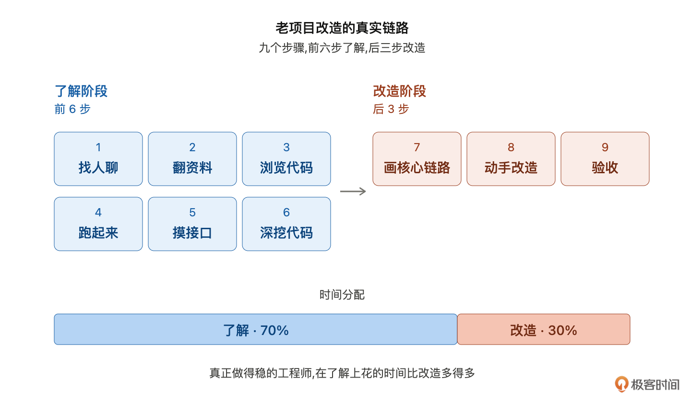

# 方法论-夯实基础

## 01 老项目改造的真实链路

## 02 AI进来后，哪一步变了，哪一步没变

- **你要知道哪些步骤属于哪一档**
    
- **第一档和第二档要快**
    
- **第三档要稳**
    
- **每一档之间的衔接要清晰**。

## 03 理解、约束、验证

### **第一层：理解，让 AI 看见**

对老项目来说，上下文不只是代码本身。还有：

- 项目是干什么的、核心业务场景有哪些
    
- 架构怎么组织、关键模块是什么
    
- 哪些接口对外暴露、哪些是内部的
    
- 数据表之间的关系、核心业务表的字段含义
    
- 代码之外的隐性约定："这段不要删"、"这个接口对接方 A 在用"

理解层对应几个动作：

- 让 AI 先画一份架构全景（ARCHITECTURE.md）
    
- 让 AI 识别出风险地带（哪些地方动了可能出事）
    
- 把以上两份东西翻译成给 AI 看的指令（CLAUDE.md）
    
- 为项目搭起文档骨架（docs 目录），后续逐步填

### **第二层：约束，让 AI 听话**

**静态约束**：写在 CLAUDE.md、SKILL.md 里的规则

**动态约束**：每次让 AI 干活时的即时指令。

### **第三层：验证，让 AI 可信**

